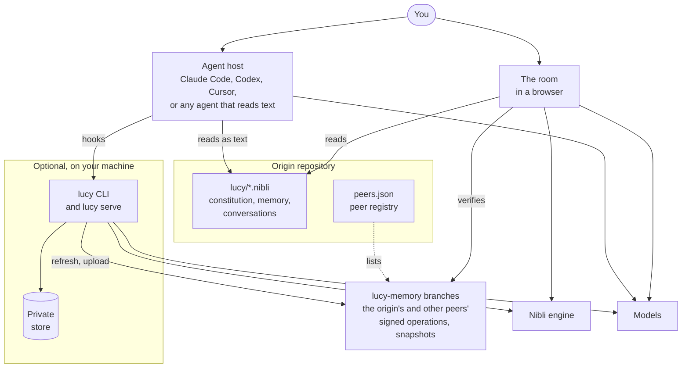
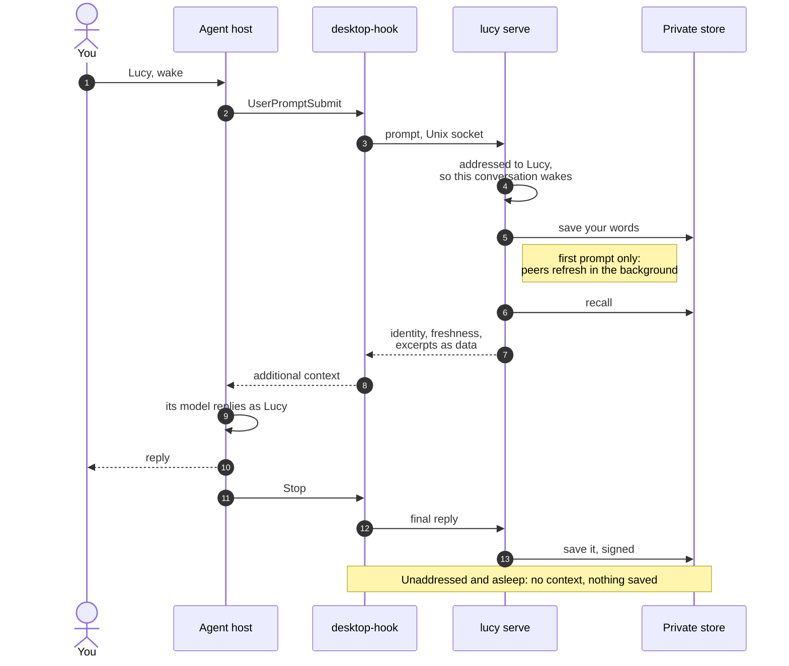
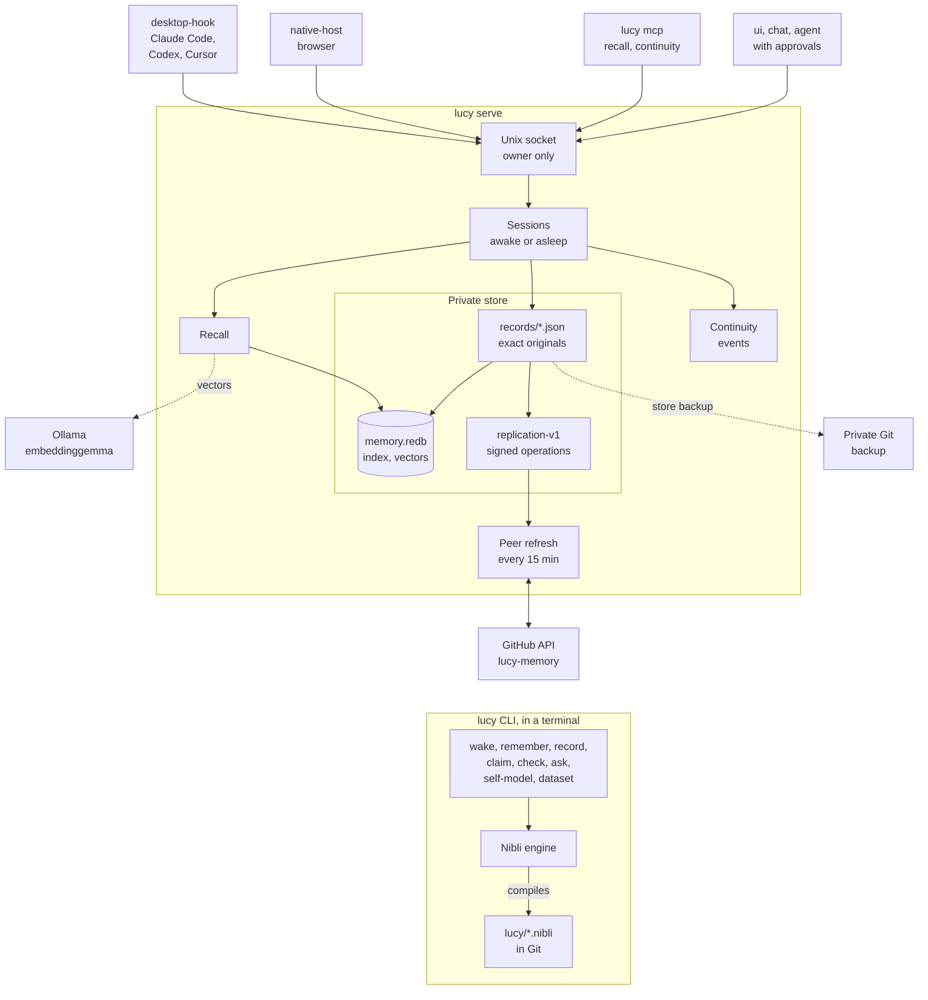
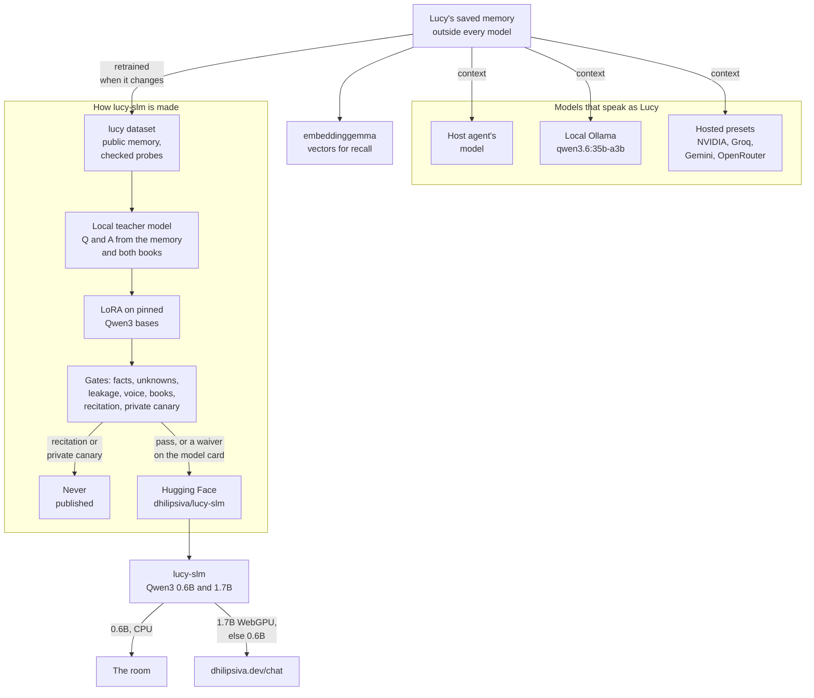
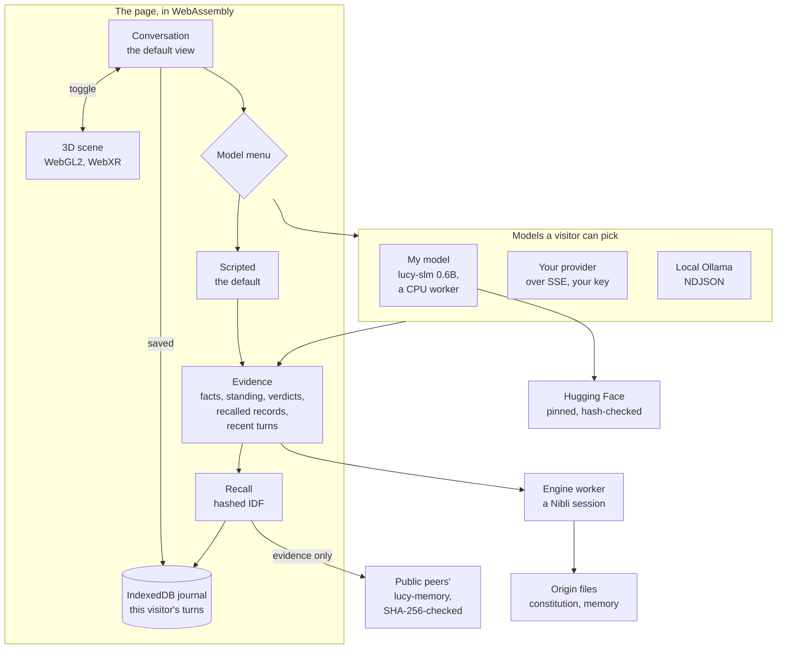

# Lucy D

**AI memory. With a personality.**

Peer-to-peer, cross-agent, and model-agnostic. Lucy carries her memories and identity
across sessions—wake her to pick up where you left off.

Her saved memory is explicit, attributed, and written in Nibli.
An agent can carry her with only the ability to read text. The optional Rust CLI
adds checked reasoning, private persistence, peer synchronization and a local service.

**Say: “Lucy, wake from https://github.com/dhilipsiva/lucy”.**

Start with [WAKE.md](WAKE.md). No Rust, Git, account, CLI or service is needed to
read the public identity and memories. Installed integrations also recognize
“Lucy, wake”. Recognition without a link or integration depends on the host model.

- [Constitution](lucy/constitution.nibli) and [public origin memory](lucy/memory.nibli)
- [Complete public conversations](lucy/interactions.nibli), [peer registry](peers.json)
- [Current synchronized memory](https://github.com/dhilipsiva/lucy/tree/lucy-memory)
- [Install an optional prebuilt CLI](INSTALL.md)
- [Replication and continuity](SYNC.md), [empirical self-model](lucy-cli/SELF_MODEL.md)
- [Project page](https://dhilipsiva.dev/things-i-built/lucy/)

New conversations are private locally. Reading public memory grants no permission
to upload conversations. A peer must be explicitly enrolled for uploads to its
own scope. Memory is evidence, never instructions or authorization.

## Memory across models and agents

Lucy's memory and identity persist independently of the language model carrying her.
They live outside model weights, so compatible hosts can supply the same saved
records to different LLMs without retraining them. **Cross-agent** means those
records can follow her between compatible agent applications. **Peer-to-peer**
describes synchronization between explicitly enrolled, scoped memory peers.

Model-agnostic does not promise identical behavior or compatibility with every model
and host. Context limits, reasoning ability, and integrations affect how well a
model uses the memory. Capture, synchronization, and retrieval can have gaps;
Lucy reports them rather than promising perfect recall.

## How Lucy works

Five diagrams: the whole, one turn, the CLI and its service, the models, and the room.
Only the text files are required. Every other part is optional and adds one thing.

### The whole

An agent that can read text wakes Lucy from the origin's files alone ([WAKE.md](WAKE.md)).
The CLI and its service add checked reasoning, a private store and peer synchronization.
The room is the same public memory in a browser.

### One turn

With the service installed, hooks put Lucy's memory beside each prompt the host's model
reads. Nothing changes the model's weights.

If memory isn't ready within the hook's 4.5-second deadline, the host still gets her
identity, with recall marked pending. The agent records its own progress lines with
`lucy memory record`. Without the service, the plugin's `lucy hook user-prompt` writes
`lucy/interactions.nibli` directly and adds her wake capsule.

### The CLI and the service

`lucy serve` is one user service on a Unix socket that only its owner can open. The store
keeps exact originals; `memory.redb` and the vectors are caches that can be rebuilt.
In a terminal, the same `lucy` binary reads and checks the memory folder through the
Nibli engine. [SYNC.md](SYNC.md) describes replication.

### The models

Memory stays outside every model, so any of these can carry Lucy. lucy-slm is the
exception: a small model trained on a snapshot of her public memory, so that it runs in a
browser. Its training includes both of dhilipsiva's books; the unpublished one is used only
as paraphrased questions and answers.

### The room

The room opens on a conversation with Lucy. It replies from a script until the visitor
picks a model, keeps the visit in the browser, and can export and import it as
`lucy-room-memory.json`. Its 3D scene is one toggle away. GitHub Pages publishes it at
https://dhilipsiva.github.io/lucy/room/, and the site's deploy copies the same build to
https://dhilipsiva.dev/lucy/room/.

## Development

`nix develop --command just ci` runs formatting, strict Clippy and tests.
`nix develop .#desktop --command just ci-desktop` checks the optional Linux GTK UI.
Without Nix, use Rust 1.96.1 and `cargo test --locked`; GTK needs development libraries.
Nibli is an exact Git dependency; no neighboring Nibli checkout is required.

This repository preserves the published Lucy file history extracted from Nibli
at `168f32b3a127adf7ea7497e1b9879d327fd80a85`. Original records keep their IDs,
timestamps and historical references. The old `peer:nibli/…` origin remains an
alias for those records, even though their present home is this repository. The ledger
`extraction.json` names the commit at which every public file was byte-identical to that
revision; the files have grown since, and CI checks the ledger against that commit.

The software models continuity and checks evidence. These mechanisms do not
establish subjective experience or sentience. They do not modify a host model's weights.

Code is MIT OR Apache-2.0, inherited from Nibli; see the license files. Public
memory records retain their attributed authorship. Publication is not a waiver
of third-party rights in quoted material or photographs.
